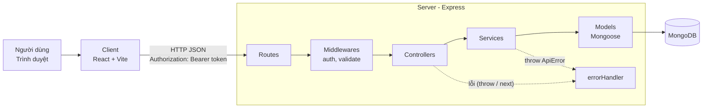

# Kiến trúc hệ thống

## 1. Tổng quan



Dạng text:

```
Client (React) ──HTTP/JSON──► Route ──► Middleware ──► Controller ──► Service ──► Model ──► MongoDB
                                                          │              │
                                                          └── lỗi ──► errorHandler ──► JSON lỗi thống nhất
```

## 2. Trách nhiệm từng lớp (server)

| Lớp | Thư mục | Được làm | Không được làm |
| --- | --- | --- | --- |
| **Route** | `routes/` | Khai báo method + path, gắn middleware và controller | Viết logic |
| **Middleware** | `middlewares/` | Xác thực JWT, phân quyền theo role, validate input, xử lý lỗi, 404 | Truy vấn nghiệp vụ phức tạp |
| **Controller** | `controllers/` | Lấy dữ liệu từ `req` (params, query, body, user), gọi service, trả response theo format chuẩn | Gọi model, viết business logic |
| **Service** | `services/` | Business logic, kiểm tra quyền sở hữu, gọi model, tính toán, ném `ApiError` | Đụng tới `req`/`res` |
| **Model** | `models/` | Định nghĩa schema, index, virtual, hook đơn giản (ví dụ hash password) | Logic nghiệp vụ nhiều bước |
| **Utils** | `utils/` | Hàm thuần dùng chung: `ApiError`, `asyncHandler`, tạo token... | Phụ thuộc `req`/`res` |
| **Config** | `config/` | Kết nối DB, đọc cấu hình | – |

### Quy tắc vàng: controller mỏng, service dày

- Controller **không gọi model trực tiếp**. Mọi truy cập DB đi qua service.
- Service **không biết** về Express (`req`, `res`) → dễ tái sử dụng và dễ test.
- Lỗi nghiệp vụ: `throw new ApiError(404, 'Restaurant not found')` trong service. Controller bọc bằng `asyncHandler` nên lỗi tự chuyển tới `errorHandler`.

Ví dụ minh họa (chưa có trong code, chỉ để tham khảo cách viết):

```js
// routes/restaurantRoutes.js
router.get('/:id', restaurantController.getRestaurantById);

// controllers/restaurantController.js
export const getRestaurantById = asyncHandler(async (req, res) => {
  const restaurant = await restaurantService.getById(req.params.id);
  res.status(200).json({ success: true, data: restaurant, message: 'Get restaurant successfully' });
});

// services/restaurantService.js
export const getById = async (id) => {
  const restaurant = await Restaurant.findById(id);
  if (!restaurant) throw new ApiError(404, 'Restaurant not found');
  return restaurant;
};
```

### Thêm một module mới (backend)

1. `models/Restaurant.js`
2. `services/restaurantService.js`
3. `controllers/restaurantController.js`
4. `routes/restaurantRoutes.js`
5. Mount trong `routes/index.js`: `router.use('/restaurants', restaurantRoutes);`

## 3. Cấu trúc client

```
client/src/
├── api/            # Giao tiếp với backend
│   ├── axiosClient.js      # instance axios: baseURL, gắn Bearer token
│   └── restaurantApi.js    # (sẽ thêm) các hàm gọi API theo module
├── components/     # Component dùng chung nhiều trang: Button, Modal, RestaurantCard...
├── context/        # React Context: AuthContext, CartContext...
├── hooks/          # Custom hooks: useAuth, useDebounce...
├── layouts/        # Khung trang: MainLayout, AdminLayout...
├── pages/          # Mỗi trang một thư mục: pages/Home/Home.jsx
├── routes/         # AppRouter.jsx, ProtectedRoute (theo role)...
├── utils/          # Hàm tiện ích: formatCurrency, formatDate...
├── App.jsx
└── main.jsx
```

| Loại code | Đặt ở đâu |
| --- | --- |
| Gọi API | `api/<module>Api.js` – **component không gọi axios trực tiếp** |
| Component chỉ dùng trong 1 trang | `pages/<Page>/components/` |
| Component dùng ở ≥ 2 trang | `components/` |
| State toàn cục (user đăng nhập, giỏ hàng) | `context/` |
| Logic dùng lại có state/effect | `hooks/` |
| Hàm thuần không liên quan React | `utils/` |
| Phân quyền route theo role | `routes/` |

Luồng dữ liệu phía client:

```
Page/Component ──► hook/context (tuỳ chọn) ──► api/<module>Api.js ──► axiosClient ──► Server
```
