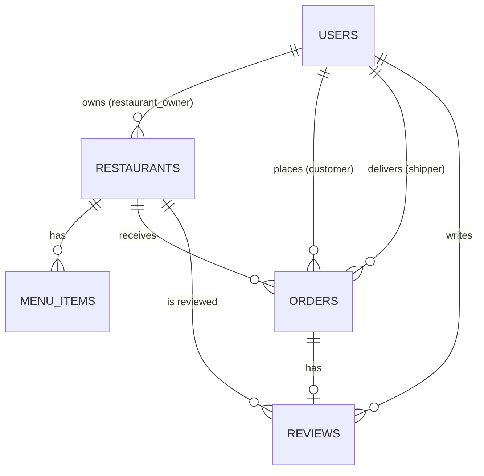
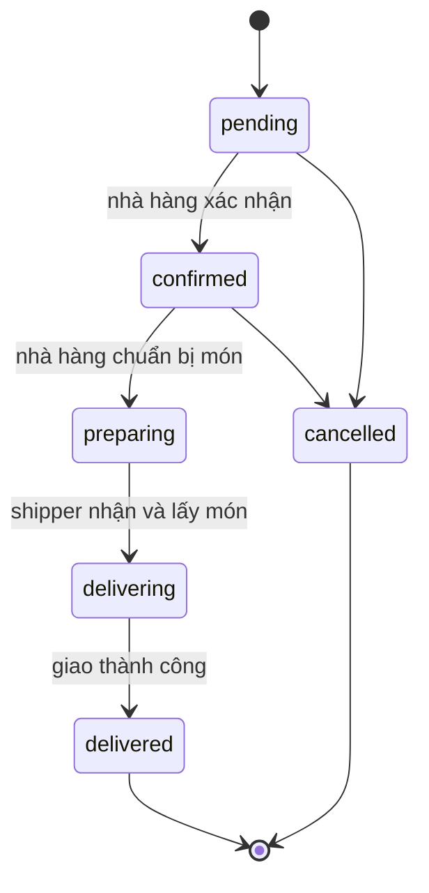

# Thiết kế cơ sở dữ liệu (khung)

> **TODO: nhóm chốt thiết kế.** Tài liệu này chỉ là bản gợi ý ban đầu. Chưa tạo Mongoose model. Sau khi nhóm thống nhất, cập nhật file này **trước** khi viết model.

- Database: MongoDB, tên DB mặc định `food_delivery`.
- Mọi collection bật `timestamps: true` (tự có `createdAt`, `updatedAt`).
- Tham chiếu giữa collection dùng `ObjectId` + `ref`.
- Tiền lưu dạng số nguyên (VND).

## Sơ đồ quan hệ (dự kiến)

## 1. `users`

| Trường | Kiểu | Ghi chú |
| --- | --- | --- |
| `fullName` | String | bắt buộc |
| `email` | String | bắt buộc, unique, lowercase |
| `password` | String | bcrypt hash, `select: false` |
| `phone` | String | |
| `role` | String | enum: `customer`, `restaurant_owner`, `shipper`, `admin`; mặc định `customer` |
| `avatar` | String | URL ảnh |
| `addresses` | Array | danh sách địa chỉ giao hàng (customer) |
| `isActive` | Boolean | admin khóa/mở tài khoản |

TODO: nhóm chốt thiết kế – thông tin riêng của shipper (biển số xe, trạng thái sẵn sàng) để chung hay tách collection?

## 2. `restaurants`

| Trường | Kiểu | Ghi chú |
| --- | --- | --- |
| `owner` | ObjectId → `users` | chủ nhà hàng |
| `name` | String | bắt buộc |
| `description` | String | |
| `address` | String | |
| `phone` | String | |
| `image` | String | URL ảnh |
| `openingHours` | Object | ví dụ `{ open: "08:00", close: "22:00" }` |
| `rating` | Number | điểm trung bình, cập nhật khi có review |
| `status` | String | enum gợi ý: `pending`, `approved`, `rejected`, `suspended` (admin duyệt) |

TODO: nhóm chốt thiết kế.

## 3. `menuItems`

| Trường | Kiểu | Ghi chú |
| --- | --- | --- |
| `restaurant` | ObjectId → `restaurants` | |
| `name` | String | bắt buộc |
| `description` | String | |
| `price` | Number | VND, ≥ 0 |
| `image` | String | |
| `category` | String | ví dụ: món chính, đồ uống... |
| `isAvailable` | Boolean | còn bán hay hết |

TODO: nhóm chốt thiết kế – category là chuỗi hay collection riêng?

## 4. `orders`

| Trường | Kiểu | Ghi chú |
| --- | --- | --- |
| `customer` | ObjectId → `users` | |
| `restaurant` | ObjectId → `restaurants` | mỗi đơn thuộc một nhà hàng |
| `shipper` | ObjectId → `users` | null cho đến khi có shipper nhận |
| `items` | Array | `[{ menuItem, name, price, quantity }]` – **lưu snapshot** tên và giá tại thời điểm đặt |
| `subtotal` | Number | |
| `shippingFee` | Number | |
| `totalPrice` | Number | |
| `deliveryAddress` | Object/String | |
| `note` | String | |
| `paymentMethod` | String | gợi ý: `cod` |
| `status` | String | xem bên dưới |
| `statusHistory` | Array | `[{ status, changedBy, changedAt }]` |
| `cancelReason` | String | |

### Trạng thái đơn hàng

`pending` → `confirmed` → `preparing` → `delivering` → `delivered`, và `cancelled`.

TODO: nhóm chốt thiết kế – ai được hủy đơn ở trạng thái nào; shipper nhận đơn ở `preparing` hay `confirmed`.

## 5. `reviews`

| Trường | Kiểu | Ghi chú |
| --- | --- | --- |
| `order` | ObjectId → `orders` | unique – mỗi đơn chỉ review một lần |
| `customer` | ObjectId → `users` | |
| `restaurant` | ObjectId → `restaurants` | |
| `rating` | Number | 1–5 |
| `comment` | String | |

Chỉ cho review khi đơn ở trạng thái `delivered`.

TODO: nhóm chốt thiết kế – có review shipper không?

## Collection có thể cần thêm

- `carts` – giỏ hàng lưu phía server (hoặc chỉ lưu ở client `localStorage`).
- `categories`, `notifications`, `vouchers`...

TODO: nhóm chốt thiết kế.
