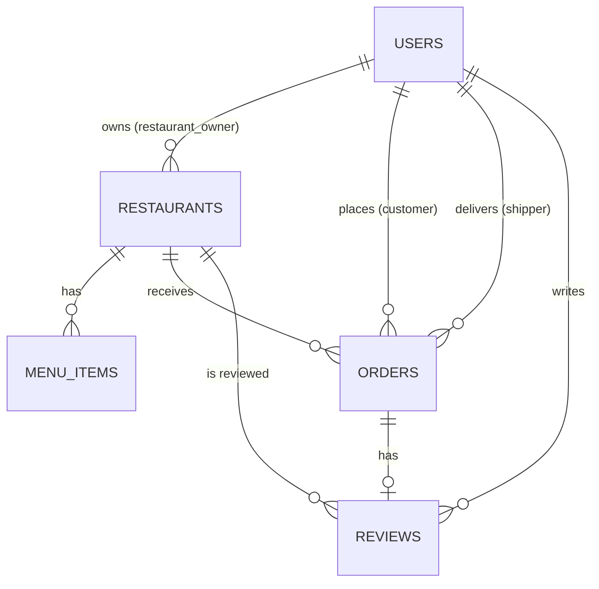
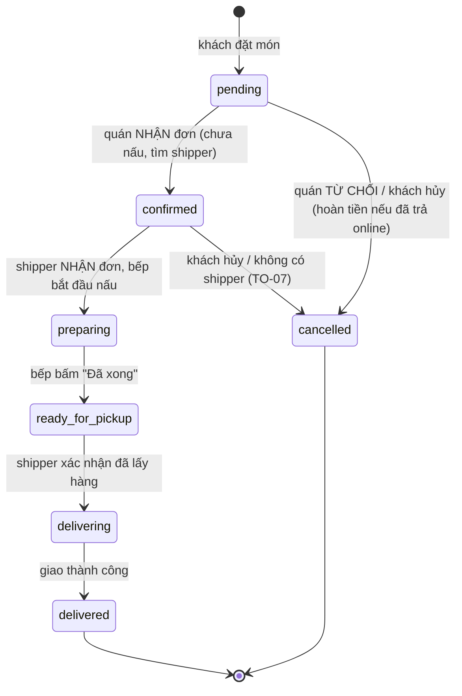

# Thiết kế cơ sở dữ liệu (khung)

> **TODO: nhóm chốt thiết kế.** Tài liệu này chỉ là bản gợi ý ban đầu. Chưa tạo Mongoose model. Sau khi nhóm thống nhất, cập nhật file này **trước** khi viết model.

- Database: MongoDB, tên DB mặc định `food_delivery_db`.
- Mọi collection bật `timestamps: true` (tự có `createdAt`, `updatedAt`).
- Tham chiếu giữa collection dùng `ObjectId` + `ref`.
- Tiền lưu dạng số nguyên (VND).

## Sơ đồ quan hệ (dự kiến)



## 1. `users`

| Trường | Kiểu | Ghi chú |
| --- | --- | --- |
| `fullName` | String | bắt buộc |
| `email` | String | bắt buộc, unique, lowercase |
| `password` | String | bcrypt hash, `select: false` |
| `phone` | String | |
| `role` | String | enum: `customer`, `restaurant_owner`, `shipper`, `admin`; mặc định `customer` |
| `avatar` | String | URL ảnh |
| `addresses` | Virtual Array | danh sách địa chỉ giao hàng (customer), lưu tại collection riêng `addresses` |
| `isActive` | Boolean | admin khóa/mở tài khoản |

TODO: nhóm chốt thiết kế – thông tin riêng của shipper (biển số xe, trạng thái sẵn sàng) để chung hay tách collection?

## 2. `restaurants`

| Trường | Kiểu | Ghi chú |
| --- | --- | --- |
| `owner` | ObjectId → `users` | chủ nhà hàng |
| `name` | String | bắt buộc |
| `description` | String | |
| `address` | String | |
| `phone` | String | |
| `logo`, `coverImage` | String | URL ảnh Cloudinary do chủ quán tải lên. Trang chủ dùng `coverImage`, thiếu thì dùng `logo` |
| `openingHours` | Object | ví dụ `{ open: "08:00", close: "22:00" }` |
| `rating` | Number | điểm trung bình, cập nhật khi có review |
| `status` | String | enum gợi ý: `pending`, `approved`, `rejected`, `suspended` (admin duyệt) |
| `statusChange` | Object | `{ note, by, at }`: quyết định gần nhất của admin (lý do từ chối / đình chỉ). Collection `shippers` có cùng trường |

TODO: nhóm chốt thiết kế.

## 3. `menuItems`

| Trường | Kiểu | Ghi chú |
| --- | --- | --- |
| `restaurant` | ObjectId → `restaurants` | |
| `name` | String | bắt buộc |
| `description` | String | |
| `price` | Number | VND, ≥ 0 |
| `image` | String | |
| `category` | String | ví dụ: món chính, đồ uống... |
| `isAvailable` | Boolean | còn bán hay hết |

**Đã triển khai (UC20):** danh mục là collection riêng `menuCategories`; model thực tế xem `server/src/models/MenuItem.js` (có `optionGroups`, `isAvailable`, `isVisible`, `soldOutAt`, `imagePublicId`, xóa mềm `isDeleted`).

**Quy tắc bắt buộc khi viết API cho khách hàng (menu, giỏ hàng, đặt món):**

- Mọi truy vấn món phải có `{ restaurant: restaurantId, isVisible: true, isDeleted: false }` – nếu thiếu, món đã ẩn/xóa sẽ lộ ra hoặc bị thêm vào giỏ.
- Món `isAvailable: false` vẫn hiển thị nhưng **không cho thêm vào giỏ** (hiện "Hết món").
- Khi tạo đơn: kiểm tra lại các điều kiện trên ở server và **lưu snapshot** tên, giá, tùy chọn đã chọn, ảnh vào đơn – không tham chiếu giá hiện tại của món.
- Không xóa cứng món: dùng xóa mềm (`isDeleted`) để đơn cũ vẫn hiển thị được.

**Nguồn món duy nhất (R02):** trang chủ (`GET /api/foods`, `/api/foods/:id`), trợ lý AI và checkout đều đọc `menuitems` – đúng thực đơn chủ quán quản lý. Chỉ lấy món của quán `approved`, `isVisible: true`, `isDeleted: false`.

- Collection `foods` (model `Food.js`) là **dữ liệu cũ**: chỉ còn cho đơn cũ (`items[].food`) và script chuyển dữ liệu. Không dùng cho tính năng mới.
- Dữ liệu có sẵn trong `foods`: chạy `npm run migrate:foods-to-menu` (chỉ in), kiểm tra rồi chạy `npm run migrate:foods-to-menu -- --apply`. Món giữ nguyên `_id` nên giỏ hàng cũ vẫn đặt được; `foods.category` thành danh mục của quán; quán đã có món cùng tên thì giữ món của quán. Chạy lại nhiều lần vẫn an toàn.
- Checkout gửi `items: [{ menuItemId, quantity, note, options: [{ groupName, name }] }]`. Server kiểm tra số lượng (số nguyên 1–99), nhóm bắt buộc, `maxSelect`, lựa chọn còn tồn tại, rồi tự tính giá từ thực đơn. Giảm giá ghi vào cả `discount` (bếp, báo cáo đọc) và `promotion.discountAmount`.
- Ảnh món / logo / ảnh bìa (R09): chỉ nhận ảnh do chính chủ quán tải lên (`food-delivery/<menu-items|restaurants>/<userId>/...`). Ảnh cũ bị thay chỉ xóa khỏi Cloudinary khi không còn nơi nào dùng, kể cả snapshot `items[].image` của đơn cũ.
- Sửa món và hồ sơ quán (R16): client gửi `expectedUpdatedAt` (giá trị `updatedAt` lúc mở form). Dữ liệu đã bị sửa ở nơi khác thì trả **409** và yêu cầu tải lại, không ghi đè. Bật/tắt "còn món" cũng tăng `updatedAt`.

## 4. `orders`

**Đã triển khai** (luồng xử lý đơn phía bếp): model thực tế xem `server/src/models/Order.js`. Module Cart & Order **dùng lại model này**, không tạo model đơn hàng khác.

| Trường | Kiểu | Ghi chú |
| --- | --- | --- |
| `orderCode` | String | `GN-0042`, duy nhất, sinh bằng `counterService.generateOrderCode()` (collection `counters`) |
| `customer` / `restaurant` / `shipper` | ObjectId | `shipper` = null cho đến khi có shipper nhận đơn |
| `items` | Array | **Snapshot lúc đặt**: `{ menuItem, name, image, unitPrice, quantity, options: [{ groupName, name, price }], note, lineTotal }` |
| `subtotal`, `packagingFee`, `shippingFee`, `discount`, `total` | Number | VND |
| `delivery` | Object | `{ recipientName, phone, address, type: 'express' \| 'standard', expectedAt }` |
| `deliveryProof` | Object | `{ imageUrl, confirmedAt }` – ảnh Cloudinary shipper bắt buộc tải lên khi xác nhận giao thành công |
| `customerNote` | String | |
| `payment` | Object | `{ method: 'cod' \| 'momo' \| 'vnpay', status: 'unpaid' \| 'paid' \| 'refunded' \| 'cancelled', paidAt, refundedAt, refundAmount }` |
| `status` | String | xem bên dưới |
| `statusHistory` | Array | `[{ status, at, byRole }]` – dòng thời gian của đơn |
| `acceptedAt`, `readyAt` | Date | quán nhận đơn / bếp làm xong |
| `kitchenTicketNo` | Number | Số phiếu bếp trong ngày (`#04`), cấp khi quán nhận đơn, đếm lại từ 1 mỗi ngày theo từng quán (bộ đếm `kitchen:<restaurantId>:<yyyymmdd>` trong `counters`) |
| `kitchenDueAt` | Date | Hạn bàn giao shipper = giờ nhận + `prepTime` của quán (mặc định 15 phút, TO-04, xem [order-timeouts.md](order-timeouts.md)) |
| `timeouts` | Object | `{ acceptRemindedAt, prepWarnedAt, prepEscalatedAt, shipperAlertedAt, pickupAlertedAt }`: các bước thời hạn đã chạy cho đơn (mỗi bước chạy một lần). `releasedAt`: lúc admin trả đơn về hàng chờ (đổi shipper) |
| `cancellation` | Object | `{ by: 'customer' \| 'restaurant' \| 'shipper' \| 'system', reason, note, at }` |
| `refund` | Object | `{ status: 'none' \| 'pending' \| 'succeeded' \| 'failed', amount, requestedAt, completedAt, reference, note, by }` – khoản hoàn tiền khi đơn đã trả online bị hủy (R06) |

### Trạng thái đơn hàng



`pending` → `confirmed` → `preparing` → `ready_for_pickup` → `delivering` → `delivered`, và `cancelled`. **Bếp chỉ nấu khi đã có shipper nhận đơn**: quán nhận đơn thì sang `confirmed` (đang tìm shipper), shipper nhận thì sang `preparing`. Chi tiết: [order-flow.md](order-flow.md).

**Quy tắc bắt buộc khi đổi trạng thái** (module Cart & Order và Shipper cũng phải theo):

- Luôn cập nhật **có điều kiện trạng thái cũ**, ví dụ `findOneAndUpdate({ _id, status: 'pending' }, ...)`, để 2 thao tác cùng lúc không đè nhau; không cập nhật được thì trả **409**.
- Mỗi lần đổi trạng thái phải `$push` một dòng vào `statusHistory` **và** gọi `recordStatusChange` (`services/orderHistoryService.js`) để timeline của khách (`order_status_history`) có đủ các bước của khách, bếp, shipper và admin (R13).
- **Hoàn tiền (R06):** hủy đơn đã trả online **không** chuyển ngay sang `refunded`. Đơn ghi `refund.status = pending` với số tiền cần hoàn, còn `payment.status` vẫn là `paid` (bên cũ: `refundStatus = pending`). Admin chuyển trả tiền rồi ghi kết quả qua `PATCH /api/admin/orders/:id/refund`:
  - `{ result: 'succeeded', reference }`: bắt buộc có mã giao dịch. Khi đó `payment.status = refunded` (kèm `refundedAt`, `refundAmount`) và các bản ghi `payments` thành công chuyển sang `refunded`.
  - `{ result: 'failed', note }`: khoản hoàn vẫn còn nợ và có thể xác nhận lại sau.
  - Lệnh cập nhật có điều kiện theo `refund.status`, nên bấm hai lần không hoàn hai lần. Danh sách đơn của admin có tab "Chờ hoàn tiền".
  - Đơn COD chưa thu tiền mà bị hủy → `payment.status = cancelled`.
- Khách hủy được khi đơn còn `pending`/`confirmed`. Lệnh hủy có điều kiện theo trạng thái và thanh toán vừa đọc (R03): nếu quán vừa nhận đơn cùng lúc thì khách nhận **409**, không thể hủy đơn đang nấu. Bảng bếp hiển thị đơn khách vừa hủy trong 10 phút.
- Chủ quán chỉ thấy số điện thoại khách đã che (`090***456`). API bếp trả đơn theo **danh sách trường cho phép** (`toRestaurantView`): không có `customer`, không có bản sao cũ `deliveryAddress` (R05).
- **Điều kiện thanh toán** (bộ lọc dùng chung trong `server/src/services/orderPolicy.js`):
  - Đơn online (MoMo/VNPay/chuyển khoản) **chưa từng thanh toán** (`unpaid`, hoặc `cancelled` khi khách hủy ở trang thanh toán) không phải đơn thật: quán **không thấy**, không thao tác được, báo cáo không tính và khách không khiếu nại được (`PLACED_ORDER_FILTER`).
  - Nhận đơn và chuyển "sẵn sàng" chỉ khi: COD đang `unpaid` (shipper thu tiền) **hoặc** online đã `paid`. Điều kiện này nằm ngay trong câu lệnh cập nhật atomic.
  - Danh sách cho shipper cũng chỉ gồm đơn có thanh toán hợp lệ.
- **Trạng thái nhà hàng khi xử lý đơn** (khác quy tắc sửa thực đơn):
  - **Nhận đơn mới**: chỉ nhà hàng `approved`. Khách chỉ đặt được khi quán trong giờ mở cửa **và** không bật tạm ngưng (`isAcceptingOrders`, xem [order-flow.md](order-flow.md) mục 4).
  - **Từ chối (hoàn tiền) và báo "Đã xong"**: được phép ở mọi trạng thái, kể cả `suspended`, để đơn đã nhận không bị kẹt và khách luôn được hoàn tiền.
  - Admin duyệt nhà hàng qua `PATCH /api/admin/restaurants/:id/status` (module Admin, xem [post-delivery-admin.md](post-delivery-admin.md)). Với dữ liệu demo, `npm run seed:orders` tự đặt nhà hàng thành `approved`.
- **Chi tiết đơn / phiếu bếp (UC23):**
  - `GET /api/restaurants/me/orders/:id` trả thêm `customerInsight: { completedOrders, isRegular }`. **Khách quen** = ≥ 3 đơn giao thành công tại quán trong 90 ngày; không trả thêm thông tin nào khác của khách.
  - `GET /api/restaurants/me/orders/lookup?code=GN-0042` tra cứu đơn của quán mình theo mã (mọi trạng thái).
  - Số phiếu bếp được ghi **trong cùng lệnh cập nhật** chuyển sang `preparing` (R14), tức lúc shipper nhận đơn, nên đơn đang nấu luôn có số phiếu. Khi 2 người bấm nhận cùng lúc, request thua bỏ phí một số, nên dãy số phiếu có thể bị nhảy (chấp nhận được).
- Shipper lấy danh sách đơn chờ qua `GET /api/orders/available-for-pickup` (đơn `confirmed`, hoặc `preparing`/`ready_for_pickup` được trả về hàng chờ; `shipper:`hearing: { openedBy, openedAt, deadline, closedBy, closedAt, remindedAt } | null`, thanh toán hợp lệ). Danh sách này **chỉ có khu vực giao** (quận, thành phố), không có tên, số điện thoại, địa chỉ chi tiết của khách; các thông tin đó chỉ trả cho shipper đã được gán đơn. Khi shipper nhận đơn `confirmed`: gán `shipper` và chuyển `preparing` (bếp nấu); khi bếp xong: `ready_for_pickup`; khi lấy hàng: `delivering`.

- **Module sau giao hàng (đánh giá, khiếu nại, sự cố) dựa vào `statusHistory`:** thời điểm giao/hủy lấy từ dòng `delivered`/`cancelled` cuối cùng. Module Shipper khi chuyển đơn sang `delivered` **bắt buộc** `$push` dòng này, nếu không thì khách sẽ không đánh giá hoặc khiếu nại được.

### Hai bộ trường thanh toán / hủy đơn (bắt buộc đọc)

Model `Order` đang có **hai bộ trường cho cùng một thông tin**:

| Bộ | Trường | Ai dùng |
| --- | --- | --- |
| **Chuẩn (nested)** | `payment.method/status/paidAt/refundAmount/refundedAt`, `cancellation.*`, `statusHistory` | Bảng bếp, shipper, thống kê admin, báo cáo doanh thu |
| Cũ (top-level) | `paymentMethod`, `paymentStatus`, `refundStatus`, `refundAmount`, `cancelledBy`, `cancelReason` | Checkout, thanh toán, màn đơn hàng của khách |

- **Mọi báo cáo và nghiệp vụ mới phải đọc bộ chuẩn.**
- Hook `pre('validate')` trong `Order.js` tự đồng bộ hai bộ **khi lưu bằng `order.save()` / `Order.create()`**: bộ nào được sửa trong lần lưu đó sẽ quyết định bộ còn lại (sửa cả hai thì bộ chuẩn thắng). Hàm chuyển đổi nằm ở `server/src/utils/orderFieldSync.js`.
- **`findOneAndUpdate` / `updateOne` KHÔNG chạy hook**: phải tự `$set` cả hai bộ (xem `rejectOrder` trong `restaurantOrderService.js`).
- `'banking'` (chuyển khoản/VietQR) là thanh toán online: chưa nhận tiền thì quán không thấy đơn, shipper không thu tiền mặt.
- Dữ liệu cũ lưu sai trước bản sửa: chạy `npm run migrate:order-fields` (chỉ in, không ghi), kiểm tra rồi chạy `npm run migrate:order-fields -- --apply`. Chạy lại nhiều lần vẫn an toàn.
- Đơn checkout (`orderNumber` dạng `ORD-...`) lấy bộ cũ làm gốc; đơn bếp/seed (`GN-...`) lấy bộ chuẩn làm gốc.

### Quy tắc của các API đơn phía khách (`/api/orders`)

- `GET /api/orders/:id`: khách chỉ xem được đơn của mình; admin xem được mọi đơn.
- `PATCH /api/orders/:id/progress` là **công cụ demo**: chỉ chủ đơn, chỉ sang `confirmed`/`preparing`/`delivering`, bị chặn khi `NODE_ENV=production`.
- `PATCH /api/orders/:id/receive`: chỉ khi đơn đang `delivering`; đơn COD tự chuyển `payment.status = paid`. Nếu đơn có shipper, việc hoàn tất đi qua cùng hàm với nút "Đã giao" của shipper (`completeDelivery` trong `shipperOrderService.js`): cộng phí giao vào ví shipper và giải phóng shipper để nhận đơn mới. Bên nào xác nhận trước thắng, không cộng tiền hai lần.

## 5. `reviews`

**Đã triển khai (UC17, UC43).** Model: `server/src/models/Review.js`. Có đánh giá shipper.

| Trường | Kiểu | Ghi chú |
| --- | --- | --- |
| `order` | ObjectId → `orders` | unique: mỗi đơn chỉ đánh giá một lần |
| `orderCode` | String | snapshot `GN-0042` để tìm kiếm |
| `customer` / `restaurant` / `shipper` | ObjectId | `shipper` = null nếu đơn không có shipper |
| `restaurantRating`, `comment` | Number 1–5, String ≤ 500 | đánh giá món ăn và nhà hàng |
| `shipperRating`, `shipperComment` | Number 1–5 / null, String ≤ 300 | bắt buộc chấm sao khi đơn có shipper |
| `isHidden`, `moderation` | Boolean, `{ reason, note, by, at }` | admin ẩn đánh giá vi phạm (UC43) |

- Chỉ đánh giá đơn `delivered`, trong **7 ngày** kể từ lúc giao.
- `restaurants.rating/ratingCount` và `shippers.rating` được **tính lại từ đầu** sau mỗi lần tạo, ẩn hoặc hiện lại một đánh giá. Đánh giá đã ẩn không được tính.

## 6. Các collection của module sau giao hàng & quản trị vận hành

Chi tiết nghiệp vụ và API xem [post-delivery-admin.md](post-delivery-admin.md).

| Collection | Model | Ghi chú |
| --- | --- | --- |
| `complaints` | `Complaint.js` | Khiếu nại của khách (UC18, UC42). `code` dạng `KN-0001`, unique theo `order`. `open → resolved \| rejected`, `resolution: { note, refundAmount, penalty, by, at }`. `hearing` và `resolution.penalty` cùng dạng với `deliveryissues` (schema dùng chung), nên lịch sử vi phạm và ngưỡng tự động đình chỉ tính cả hai collection |
| `deliveryissues` | `DeliveryIssue.js` | Báo cáo sự cố của shipper (UC34, UC45). `code` dạng `SC-0001`, tối đa 1 báo cáo `open` cho mỗi đơn (unique partial index). `resolution.penalty: { target, targetUser, action, fineAmount, autoSuspended }` là lịch sử vi phạm (`autoSuspended`: lần phạt này chạm ngưỡng của `violation_settings` nên tài khoản bị tự động đình chỉ). `resolution.orderAction`: `none` \| `release` \| `cancel` (admin xử lý đơn shipper không giao tiếp được, làm riêng trước khi kết luận; kèm `orderActionBy/orderActionAt`). `hearing: { openedBy, openedAt, deadline, closedBy, closedAt, remindedAt } | null`\| null`: phiên đối chất giữa shipper, khách, chủ quán (tối đa 24 giờ), bắt buộc đã kết thúc trước khi xử phạt |
| `hearing_messages` | `HearingMessage.js` | Tin nhắn của phiên đối chất (sự cố và khiếu nại): `caseType` (`delivery_issue` \| `complaint`), `caseId`, `sender`, `party` (`shipper` \| `customer` \| `restaurant` \| `admin`), `message` (≤ 1000 ký tự). Index `{ caseType, caseId, createdAt }`. Thay cho `issue_messages` cũ (chỉ có dữ liệu seed, chạy lại `seed:feedback` để tạo lại) |
| `commissionrules` | `CommissionRule.js` | Hoa hồng nền tảng (UC40): `target` restaurant (% tiền món) hoặc shipper (% phí giao), `restaurant` null = mặc định, `effectiveFrom/effectiveTo` dạng `YYYY-MM-DD` (ngày Việt Nam) |
| `promotion_rules` | `PromotionRule.js` | Mã khuyến mãi (UC41). **Dùng chung model với checkout (UC14)**, không đổi tên trường |
| `restaurant_vouchers` | `RestaurantVoucher.js` | Voucher quán tự chạy, quán chịu tiền: `code` (unique theo quán), `discountType`, `discountValue`, `maxDiscount`, `minOrderValue`, `startAt`/`endAt`, `usageLimit`, `perCustomerLimit`, `isActive`. Đơn lưu bản sao ở `orders.restaurantVoucher`. Xem [restaurant-voucher.md](restaurant-voucher.md) |
| `users.payoutAccounts` | (trong `User.js`) | Tài khoản ngân hàng nhận tiền rút của customer và shipper, cùng quy tắc với quán (tối đa 5, một mặc định). API `/api/wallet/payout-accounts` |
| `restaurants.payoutAccounts` | (trong `Restaurant.js`) | Tối đa 5 tài khoản ngân hàng nhận tiền rút `{ bankName, accountNumber, accountHolder, isDefault }`; `restaurants.payoutAccount` là bản sao của tài khoản mặc định |
| `restaurant_wallets` | `RestaurantWallet.js` | Ví của quán (mỗi quán một document): `withdrawnTotal`, `weekStart`/`weekCount` (giới hạn 3 lần rút/tuần), `version` (compare-and-set). Số dư tính từ đơn, xem [restaurant-wallet.md](restaurant-wallet.md) |
| `restaurant_withdrawals` | `RestaurantWithdrawal.js` | Lệnh rút tiền `RT-0001`: `amount`, bản sao `bankAccount`, `status` `processing → succeeded \| failed`, `providerRef`, `idempotencyKey` (unique theo quán) |
| `order_messages` | `OrderMessage.js` | Tin nhắn theo đơn: `order`, `sender`, `message`; chỉ khách đặt đơn và shipper đang được gán có quyền đọc/gửi |

## 7. `platform_settings`

Tham số thời hạn xử lý đơn mà admin chỉnh được (một document `_id: "order-timeouts"`). Danh sách tham số, giá trị mặc định và decision log: [order-timeouts.md](order-timeouts.md). Hủy đơn bởi hệ thống ghi `cancellation.by = 'system'`, `reason` là `accept_timeout` (tính lỗi cho quán), `no_shipper`, `admin_cancel` hoặc `delivery_issue` (admin hủy khi xử lý sự cố giao hàng).

Ngưỡng tự động đình chỉ khi vi phạm nằm ở collection riêng `violation_settings` (`ViolationSetting.js`, một document `_id: "default"`): `autoSuspendThreshold` (mặc định 3, `0` = tắt). Xem [post-delivery-admin.md](post-delivery-admin.md) mục 3.

Nhà hàng có thêm `prepTime` (5–120 phút). Lịch rỗng = đóng cửa: không hiện trên trang chủ, không nhận đơn (admin vẫn duyệt được hồ sơ). Không có ca qua đêm.

## 8. Trường đã bỏ (refactor/db-cleanup)

Các trường dưới đây đã bị xóa khỏi model vì không còn code nào đọc. **Không dùng lại**; nếu cần thông tin tương ứng, dùng cột "Thay bằng".

| Trường đã bỏ | Lý do | Thay bằng |
| --- | --- | --- |
| `notifications.sender` | Không chỗ nào ghi, luôn `null` | (không cần) |
| `restaurants.image` | Chỉ là bản sao avatar chủ quán, chủ quán không sửa được | `coverImage` / `logo` |
| `restaurants.isVerified` | Ghi theo trạng thái duyệt, không ai đọc | `status === 'approved'` |
| `shippers.isOnline` | Đặt `true` lúc đăng ký và không bao giờ đổi | `driverdashboards.isOnline` (nút bật/tắt nhận đơn) |
| `users.deliveryAddress` | Bản sao tên đường của địa chỉ mặc định, client không đọc | Collection riêng `addresses` |
| `users.addresses` | Mảng nhúng trong User gây phình to khi auth, khó đánh index địa lý | Collection riêng `addresses` (`/api/addresses`) |
| `orders.delivery.distanceKm` | Trùng `orders.distanceKm` | `orders.distanceKm` |
| `platform_settings.reconInterval`, `refundSlaHours` | Lưu trên màn Cấu hình vận hành nhưng không code nào đọc | (không cần) |

Dữ liệu cũ trên DB vẫn còn các trường này cho tới khi chạy migration (Mongoose bỏ qua chúng nên app vẫn chạy bình thường):

```bash
cd server && npm run migrate:drop-unused-fields            # chỉ đếm, không ghi
cd server && npm run migrate:drop-unused-fields -- --apply # $unset các trường
cd server && npm run migrate:addresses -- --apply          # chuyển địa chỉ sang collection addresses
```

Chưa xóa trong đợt này (còn đang được dùng hoặc cần cả nhóm thống nhất): collection `foods` (đợi chạy `migrate:foods-to-menu` trên Atlas), bộ trường cũ của `orders` (checkout và màn khách còn đọc), trạng thái đơn `confirmed`.

## Collection có thể cần thêm

- `carts` – giỏ hàng lưu phía server (hoặc chỉ lưu ở client `localStorage`).
- `categories`, `notifications`...

TODO: nhóm chốt thiết kế.
