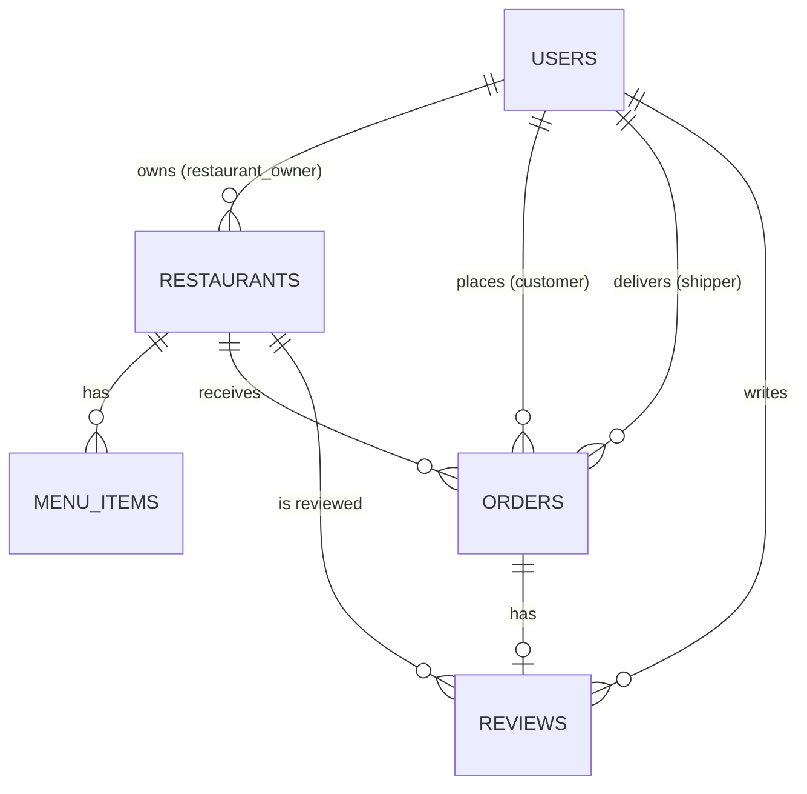
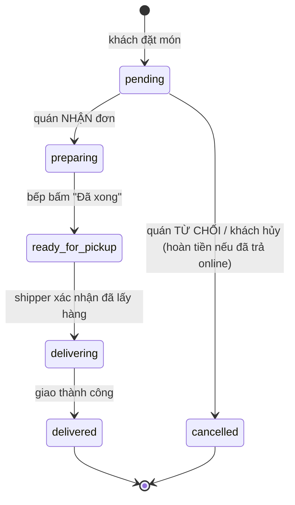

# Thiết kế cơ sở dữ liệu (khung)

> **TODO: nhóm chốt thiết kế.** Tài liệu này chỉ là bản gợi ý ban đầu. Chưa tạo Mongoose model. Sau khi nhóm thống nhất, cập nhật file này **trước** khi viết model.

- Database: MongoDB, tên DB mặc định `food_delivery`.
- Mọi collection bật `timestamps: true` (tự có `createdAt`, `updatedAt`).
- Tham chiếu giữa collection dùng `ObjectId` + `ref`.
- Tiền lưu dạng số nguyên (VND).

## Sơ đồ quan hệ (dự kiến)

## 1. `users`

| Trường | Kiểu | Ghi chú |
| --- | --- | --- |
| `fullName` | String | bắt buộc |
| `email` | String | bắt buộc, unique, lowercase |
| `password` | String | bcrypt hash, `select: false` |
| `phone` | String | |
| `role` | String | enum: `customer`, `restaurant_owner`, `shipper`, `admin`; mặc định `customer` |
| `avatar` | String | URL ảnh |
| `addresses` | Array | danh sách địa chỉ giao hàng (customer) |
| `isActive` | Boolean | admin khóa/mở tài khoản |

TODO: nhóm chốt thiết kế – thông tin riêng của shipper (biển số xe, trạng thái sẵn sàng) để chung hay tách collection?

## 2. `restaurants`

| Trường | Kiểu | Ghi chú |
| --- | --- | --- |
| `owner` | ObjectId → `users` | chủ nhà hàng |
| `name` | String | bắt buộc |
| `description` | String | |
| `address` | String | |
| `phone` | String | |
| `image` | String | URL ảnh |
| `openingHours` | Object | ví dụ `{ open: "08:00", close: "22:00" }` |
| `rating` | Number | điểm trung bình, cập nhật khi có review |
| `status` | String | enum gợi ý: `pending`, `approved`, `rejected`, `suspended` (admin duyệt) |

TODO: nhóm chốt thiết kế.

## 3. `menuItems`

| Trường | Kiểu | Ghi chú |
| --- | --- | --- |
| `restaurant` | ObjectId → `restaurants` | |
| `name` | String | bắt buộc |
| `description` | String | |
| `price` | Number | VND, ≥ 0 |
| `image` | String | |
| `category` | String | ví dụ: món chính, đồ uống... |
| `isAvailable` | Boolean | còn bán hay hết |

**Đã triển khai (UC20):** danh mục là collection riêng `menuCategories`; model thực tế xem `server/src/models/MenuItem.js` (có `optionGroups`, `isAvailable`, `isVisible`, `soldOutAt`, `imagePublicId`, xóa mềm `isDeleted`).

**Quy tắc bắt buộc khi viết API cho khách hàng (menu, giỏ hàng, đặt món):**

- Mọi truy vấn món phải có `{ restaurant: restaurantId, isVisible: true, isDeleted: false }` – nếu thiếu, món đã ẩn/xóa sẽ lộ ra hoặc bị thêm vào giỏ.
- Món `isAvailable: false` vẫn hiển thị nhưng **không cho thêm vào giỏ** (hiện "Hết món").
- Khi tạo đơn: kiểm tra lại các điều kiện trên ở server và **lưu snapshot** tên, giá, tùy chọn đã chọn, ảnh vào đơn – không tham chiếu giá hiện tại của món.
- Không xóa cứng món: dùng xóa mềm (`isDeleted`) để đơn cũ vẫn hiển thị được.

## 4. `orders`

**Đã triển khai** (luồng xử lý đơn phía bếp): model thực tế xem `server/src/models/Order.js`. Module Cart & Order **dùng lại model này**, không tạo model đơn hàng khác.

| Trường | Kiểu | Ghi chú |
| --- | --- | --- |
| `orderCode` | String | `GN-0042`, duy nhất, sinh bằng `counterService.generateOrderCode()` (collection `counters`) |
| `customer` / `restaurant` / `shipper` | ObjectId | `shipper` = null cho đến khi có shipper nhận đơn |
| `items` | Array | **Snapshot lúc đặt**: `{ menuItem, name, image, unitPrice, quantity, options: [{ groupName, name, price }], note, lineTotal }` |
| `subtotal`, `packagingFee`, `shippingFee`, `discount`, `total` | Number | VND |
| `delivery` | Object | `{ recipientName, phone, address, type: 'express' \| 'standard', expectedAt }` |
| `customerNote` | String | |
| `payment` | Object | `{ method: 'cod' \| 'momo' \| 'vnpay', status: 'unpaid' \| 'paid' \| 'refunded' \| 'cancelled', paidAt, refundedAt, refundAmount }` |
| `status` | String | xem bên dưới |
| `statusHistory` | Array | `[{ status, at, byRole }]` – dòng thời gian của đơn |
| `acceptedAt`, `readyAt` | Date | quán nhận đơn / bếp làm xong |
| `kitchenTicketNo` | Number | Số phiếu bếp trong ngày (`#04`), cấp khi quán nhận đơn, đếm lại từ 1 mỗi ngày theo từng quán (bộ đếm `kitchen:<restaurantId>:<yyyymmdd>` trong `counters`) |
| `kitchenDueAt` | Date | Hạn bàn giao shipper = giờ nhận + thời gian chuẩn bị (Giao nhanh 10 phút / Tiêu chuẩn 20 phút, xem `services/orderTiming.js`) |
| `cancellation` | Object | `{ by: 'customer' \| 'restaurant' \| 'shipper' \| 'system', reason, note, at }` |

### Trạng thái đơn hàng

`pending` → `preparing` → `ready_for_pickup` → `delivering` → `delivered`, và `cancelled`. **Không còn trạng thái `confirmed`**: quán nhận đơn là chuyển thẳng sang chuẩn bị món.

**Quy tắc bắt buộc khi đổi trạng thái** (module Cart & Order và Shipper cũng phải theo):

- Luôn cập nhật **có điều kiện trạng thái cũ**, ví dụ `findOneAndUpdate({ _id, status: 'pending' }, ...)`, để 2 thao tác cùng lúc không đè nhau; không cập nhật được thì trả **409**.
- Mỗi lần đổi trạng thái phải `$push` một dòng vào `statusHistory`.
- Hủy đơn đã trả online → `payment.status = refunded` + `refundedAt` + `refundAmount` (hiện là **mô phỏng**, chưa nối cổng thanh toán). Đơn COD chưa thu → `payment.status = cancelled`.
- Khách chỉ được hủy khi đơn còn `pending`. Bảng bếp hiển thị đơn khách vừa hủy trong 10 phút.
- Chủ quán chỉ thấy số điện thoại khách đã che (`090***456`).
- **Điều kiện thanh toán** (bộ lọc dùng chung trong `server/src/services/orderPolicy.js`):
  - Đơn online (MoMo/VNPay) **chưa thanh toán** (`unpaid`) là đơn khách đang trả tiền: quán **không thấy** và không thao tác được.
  - Nhận đơn và chuyển "sẵn sàng" chỉ khi: COD đang `unpaid` (shipper thu tiền) **hoặc** online đã `paid`. Điều kiện này nằm ngay trong câu lệnh cập nhật atomic.
  - Danh sách cho shipper cũng chỉ gồm đơn có thanh toán hợp lệ.
- **Trạng thái nhà hàng khi xử lý đơn** (khác quy tắc sửa thực đơn):
  - **Nhận đơn mới**: chỉ nhà hàng `approved`.
  - **Từ chối (hoàn tiền) và báo "Đã xong"**: được phép ở mọi trạng thái, kể cả `suspended`, để đơn đã nhận không bị kẹt và khách luôn được hoàn tiền.
  - Admin duyệt nhà hàng qua `PATCH /api/admin/restaurants/:id/status` (module Admin). Với dữ liệu demo, `npm run seed:orders` tự đặt nhà hàng thành `approved`.
- **Chi tiết đơn / phiếu bếp (UC23):**
  - `GET /api/restaurants/me/orders/:id` trả thêm `customerInsight: { completedOrders, isRegular }`. **Khách quen** = ≥ 3 đơn giao thành công tại quán trong 90 ngày; không trả thêm thông tin nào khác của khách.
  - `GET /api/restaurants/me/orders/lookup?code=GN-0042` tra cứu đơn của quán mình theo mã (mọi trạng thái).
  - Số phiếu bếp được cấp **sau khi** nhận đơn thành công, nên request thua khi 2 người bấm cùng lúc không làm nhảy số.
- Shipper lấy danh sách đơn chờ qua `GET /api/orders/available-for-pickup` (đơn `ready_for_pickup`, `shipper: null`, thanh toán hợp lệ). Danh sách này **chỉ có khu vực giao** (quận, thành phố), không có tên, số điện thoại, địa chỉ chi tiết của khách; các thông tin đó chỉ trả cho shipper đã được gán đơn. Khi shipper nhận đơn: gán `shipper` (trạng thái vẫn `ready_for_pickup`); khi lấy hàng: chuyển `delivering`.

- **Module sau giao hàng (đánh giá, khiếu nại, sự cố) dựa vào `statusHistory`:** thời điểm giao/hủy lấy từ dòng `delivered`/`cancelled` cuối cùng. Module Shipper khi chuyển đơn sang `delivered` **bắt buộc** `$push` dòng này, nếu không thì khách sẽ không đánh giá hoặc khiếu nại được.

## 5. `reviews`

**Đã triển khai (UC17, UC43).** Model: `server/src/models/Review.js`. Có đánh giá shipper.

| Trường | Kiểu | Ghi chú |
| --- | --- | --- |
| `order` | ObjectId → `orders` | unique: mỗi đơn chỉ đánh giá một lần |
| `orderCode` | String | snapshot `GN-0042` để tìm kiếm |
| `customer` / `restaurant` / `shipper` | ObjectId | `shipper` = null nếu đơn không có shipper |
| `restaurantRating`, `comment` | Number 1–5, String ≤ 500 | đánh giá món ăn và nhà hàng |
| `shipperRating`, `shipperComment` | Number 1–5 / null, String ≤ 300 | bắt buộc chấm sao khi đơn có shipper |
| `isHidden`, `moderation` | Boolean, `{ reason, note, by, at }` | admin ẩn đánh giá vi phạm (UC43) |

- Chỉ đánh giá đơn `delivered`, trong **7 ngày** kể từ lúc giao.
- `restaurants.rating/ratingCount` và `shippers.rating` được **tính lại từ đầu** sau mỗi lần tạo, ẩn hoặc hiện lại một đánh giá. Đánh giá đã ẩn không được tính.

## 6. Các collection của module sau giao hàng & quản trị vận hành

Chi tiết nghiệp vụ và API xem [post-delivery-admin.md](post-delivery-admin.md).

| Collection | Model | Ghi chú |
| --- | --- | --- |
| `complaints` | `Complaint.js` | Khiếu nại của khách (UC18, UC42). `code` dạng `KN-0001`, unique theo `order`. `open → resolved \| rejected`, `resolution: { note, refundAmount, by, at }` |
| `deliveryissues` | `DeliveryIssue.js` | Báo cáo sự cố của shipper (UC34, UC45). `code` dạng `SC-0001`, tối đa 1 báo cáo `open` cho mỗi đơn (unique partial index). `resolution.penalty: { target, targetUser, action, fineAmount }` là lịch sử vi phạm |
| `commissionrules` | `CommissionRule.js` | Hoa hồng nền tảng (UC40): `target` restaurant (% tiền món) hoặc shipper (% phí giao), `restaurant` null = mặc định, `effectiveFrom/effectiveTo` dạng `YYYY-MM-DD` (ngày Việt Nam) |
| `promotion_rules` | `PromotionRule.js` | Mã khuyến mãi (UC41). **Dùng chung model với checkout (UC14)**, không đổi tên trường |

## Collection có thể cần thêm

- `carts` – giỏ hàng lưu phía server (hoặc chỉ lưu ở client `localStorage`).
- `categories`, `notifications`...

TODO: nhóm chốt thiết kế.
