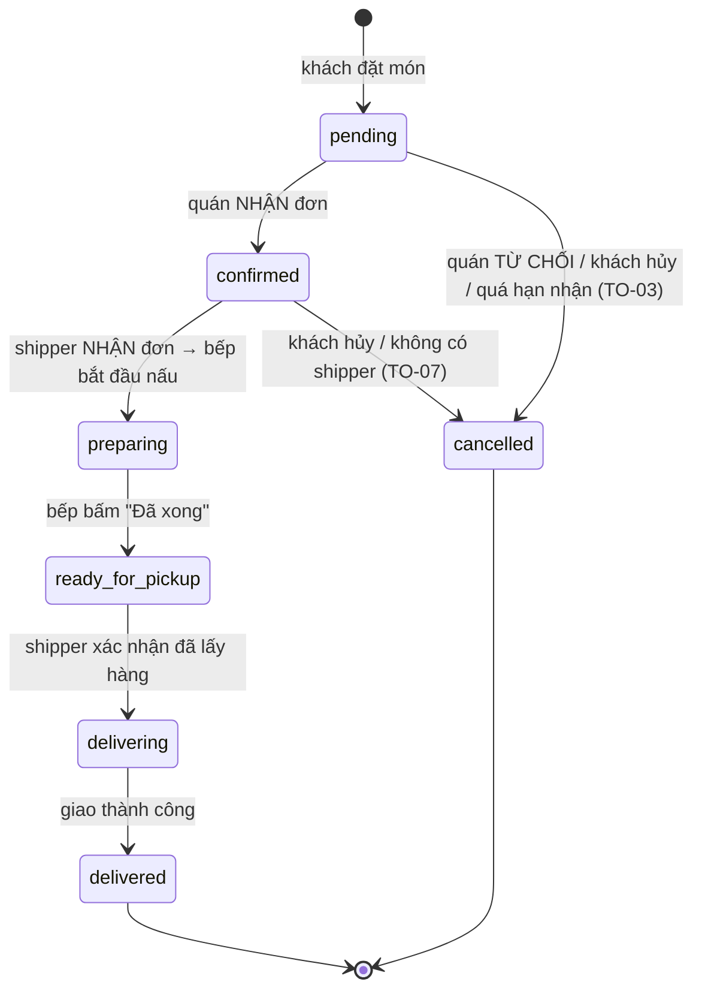

# Luồng xử lý đơn hàng: quán nhận → shipper nhận → bếp nấu

Tài liệu nghiệp vụ cho nhóm (BA, dev nhà hàng, dev shipper, dev admin). Quy tắc thời hạn chi tiết xem [order-timeouts.md](order-timeouts.md).

## 1. Nguyên tắc

**Bếp chỉ nấu khi đã có shipper nhận giao.** Quán nhận đơn xong thì chưa nấu: đơn được đưa cho shipper, và bếp bắt đầu nấu ngay khi có một shipper nhận đơn. Nếu không có shipper, đơn tự hủy mà quán chưa tốn nguyên liệu.

## 2. Các bước

| Trạng thái | Ý nghĩa | Bảng bếp | Shipper |
| --- | --- | --- | --- |
| `pending` | Khách đã đặt, chờ quán xác nhận | Cột "Đơn mới": Nhận / Từ chối | Không thấy |
| `confirmed` | Quán đã nhận, **đang tìm shipper**, bếp chưa nấu | Cột "Chờ shipper nhận" (đếm giờ tự hủy) | Thấy trong "Đơn có thể nhận" |
| `preparing` | Shipper đã nhận, **bếp đang nấu** (`kitchenDueAt` = lúc shipper nhận + `prepTime`) | Cột "Đang chuẩn bị": nút "Đã xong" | Đơn đang giữ, đi tới quán; chưa bấm "Đã lấy" được |
| `ready_for_pickup` | Món xong, chờ shipper lấy | Cột "Sẵn sàng lấy hàng" | Bấm "Xác nhận đã lấy" |
| `delivering` → `delivered` | Đang giao / đã giao | Rời bảng | Giao cho khách |

- **Số phiếu bếp** và hạn bàn giao được ghi lúc shipper nhận đơn (lúc bếp thật sự bắt đầu), không phải lúc quán nhận.
- **Khách hủy** được khi đơn còn `pending` hoặc `confirmed` (bếp chưa nấu). Từ `preparing` trở đi khách không tự hủy được.
- **Quán từ chối** chỉ ở `pending`. Đơn `confirmed` mà không có shipper sẽ tự hủy theo TO-07, không tính lỗi cho quán.

## 3. Shipper trả đơn / admin đổi shipper

- Shipper được trả đơn trong **3 phút** sau khi nhận và trước khi lấy hàng. Admin có thể đổi shipper khi shipper đã nhận nhưng chưa lấy hàng.
- Đơn được trả về hàng chờ **giữ nguyên trạng thái bếp** (`preparing` hoặc `ready_for_pickup`): bếp không dừng nấu. Shipper khác nhận lại thì chỉ gán shipper, không cấp số phiếu mới.
- Mốc `timeouts.releasedAt` được ghi lại: TO-06/TO-07 tính lại từ mốc này. Nếu sau đó vẫn không có shipper và đơn tự hủy, món đã nấu không được bù tự động (decision D2).

## 4. Nút tạm ngưng nhận đơn

Chủ quán bật/tắt trên bảng bếp (nút "Đang nhận đơn / Tạm ngưng nhận đơn"), dùng khi bếp không có người làm hoặc quá đông đơn.

- `PATCH /api/restaurants/me/accepting-orders` body `{ "isAcceptingOrders": false | true }`. Lưu ở `restaurants.isAcceptingOrders` (mặc định `true`) và `acceptingOrdersChangedAt`.
- Khi tạm ngưng: trang chủ hiện quán như đã đóng cửa ("Tạm ngưng nhận đơn"), khách không thêm món vào giỏ, và **server từ chối tạo đơn** (kiểm tra cùng chỗ với giờ mở cửa và ngừng nhận trước giờ đóng).
- Đơn đã có trên bảng **không bị ảnh hưởng**: quán vẫn nhận, nấu và bàn giao bình thường.
- Đổi trạng thái không làm thay đổi `updatedAt` của hồ sơ, nên form hồ sơ đang mở ở tab khác không bị báo xung đột (409).
- Không tự mở lại: chủ quán phải bấm mở lại.

## 5. API liên quan

| Method | Endpoint | Thay đổi |
| --- | --- | --- |
| PATCH | `/api/restaurants/me/orders/:id/accept` | `pending` → `confirmed`, gửi `new_pickup_order` cho shipper |
| PATCH | `/api/orders/:id/shipper/accept` | Đơn `confirmed` → `preparing` (bếp nấu, có số phiếu); đơn đã được trả về hàng chờ chỉ gán shipper |
| PATCH | `/api/restaurants/me/orders/:id/ready` | `preparing` → `ready_for_pickup` |
| GET | `/api/orders/available-for-pickup` | Đơn `confirmed` / `preparing` / `ready_for_pickup` chưa có shipper, thanh toán hợp lệ |
| GET | `/api/restaurants/me/orders/board` | Thêm nhóm `confirmed` (kèm `waitingShipperSince`, `shipperDeadline`); thẻ đang nấu có `cookingStartedAt` |
| PATCH | `/api/restaurants/me/accepting-orders` | Tạm ngưng / mở nhận đơn |

## 6. Đơn cũ trước khi đổi luồng

Không cần migration. Đơn `preparing` cũ (bếp đã nấu, chưa có shipper) hiện trong danh sách cho shipper và nhận như đơn được trả về hàng chờ. Đơn `ready_for_pickup` cũ chưa có shipper vẫn theo TO-06/TO-07 tính từ `readyAt`.
