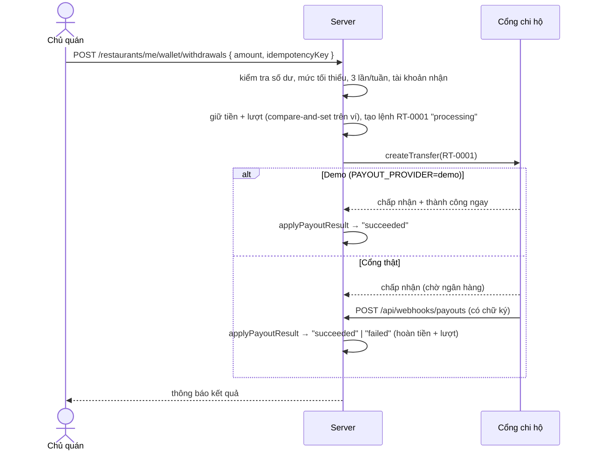

# Ví nhà hàng & rút tiền

Tài liệu nghiệp vụ cho nhóm. Màn hình: **Thống kê → Ví & rút tiền** (`/restaurant/revenue?tab=wallet`), có lối tắt từ menu tài khoản. Tài khoản ngân hàng nhận tiền cũng được khai báo ngay trong màn hình này.

## 1. Tiền vào ví

- **Thực nhận** của mỗi đơn hoàn thành = tiền món + phí đóng gói − voucher quán − phí nền tảng. Phí nền tảng = (tiền món − voucher quán) × tỉ lệ hoa hồng admin cấu hình, theo ngày đặt đơn ([restaurant-voucher.md](restaurant-voucher.md)). Mã của nền tảng do nền tảng chịu. Phí giao hàng thuộc shipper.
- Tiền vào ví sau **đối soát cuối ngày (T+1)**: thực nhận của các ngày trước hôm nay là **"Đã vào ví"**, đơn của hôm nay là **"Chờ đối soát"** và vào ví sau 0h.
- Số dư không lưu sẵn mà tính lại từ đơn bằng cùng công thức và cùng cách làm tròn theo ngày với tab **Chi tiết hoa hồng**, nên ví và sao kê luôn khớp nhau.

| Số trên màn hình | Ý nghĩa |
| --- | --- |
| Số dư khả dụng | Đã vào ví − (lệnh rút đang xử lý + lệnh rút thành công) |
| Chờ đối soát | Thực nhận của đơn hoàn thành hôm nay |
| Đang xử lý | Lệnh rút đã gửi, đang chờ ngân hàng |
| Đã rút | Tổng lệnh rút thành công |
| Tổng thu nhập | Đã vào ví + chờ đối soát |

## 2. Quy định rút tiền

| Quy định | Giá trị |
| --- | --- |
| Số tiền tối thiểu mỗi lần | 50.000đ (`MIN_WITHDRAWAL_AMOUNT`) |
| Số tiền tối đa | Không vượt số dư khả dụng |
| Số lần | Tối đa **3 lần mỗi tuần** (Thứ Hai – Chủ Nhật, giờ Việt Nam), làm mới vào Thứ Hai (`MAX_WITHDRAWALS_PER_WEEK`) |
| Lệnh thất bại | Hoàn tiền vào ví và **không tính lượt** |
| Tài khoản nhận | Khai báo trong ví, mục "Tài khoản nhận tiền": đủ ngân hàng, số tài khoản 6–20 chữ số, tên chủ tài khoản viết hoa không dấu. Đổi tài khoản phải xác nhận lại, chủ quán nhận thông báo, ghi `payoutAccountChangedAt`. Lệnh rút lưu bản sao tài khoản tại thời điểm rút |
| Quán bị tạm ngưng (`suspended`) | Ví tạm khóa, liên hệ quản trị viên |

## 3. Luồng một lệnh rút



- Trạng thái lệnh: `processing` → `succeeded` | `failed`.
- **Chống trùng:** client gửi `idempotencyKey` (UUID, một khóa cho mỗi lần điền form). Bấm hai lần hoặc gửi lại sau khi mất mạng sẽ trả về đúng lệnh cũ, không tạo lệnh chuyển thứ hai.
- **Chống rút vượt:** số tiền đã rút và số lượt trong tuần nằm trên một document `restaurant_wallets`. Mỗi lệnh rút cập nhật có điều kiện theo `version` vừa đọc, nên hai lệnh gửi cùng lúc thì chỉ một lệnh thắng, lệnh kia nhận **409**.
- **Demo:** cổng `demo` duyệt lệnh ngay và không chuyển tiền thật, nhưng kết quả vẫn đi qua `applyPayoutResult`, cùng hàm mà webhook dùng. Khi tích hợp cổng thật chỉ cần thay `createTransfer` trong `services/payoutGateway.js`.

## 4. Webhook chi hộ

`POST /api/webhooks/payouts` (không dùng JWT)

```json
{ "reference": "RT-0001", "status": "succeeded", "providerRef": "BANK-123", "failureReason": "" }
```

- Header `x-payout-signature`: chuỗi hex HMAC-SHA256 của **raw body**, ký bằng `PAYOUT_WEBHOOK_SECRET`. Sai hoặc thiếu chữ ký → 401; server chưa cấu hình secret → 503.
- `status`: `succeeded` hoặc `failed`. Chỉ lệnh đang `processing` mới đổi được trạng thái. Gửi lặp lại vẫn trả 200 với `changed: false`, để cổng không gửi lại mãi. Lệnh đã thành công không thể chuyển sang thất bại.
- `failed`: hoàn tiền vào ví và trả lại lượt rút nếu vẫn còn trong tuần đó.
- Ví dụ gọi thử (PowerShell, cần Node):

```powershell
$body = '{"reference":"RT-0001","status":"succeeded","providerRef":"BANK-123"}'
$sig = node -e "console.log(require('crypto').createHmac('sha256', process.env.PAYOUT_WEBHOOK_SECRET).update(process.argv[1]).digest('hex'))" $body
Invoke-RestMethod -Method Post -Uri http://localhost:5000/api/webhooks/payouts -ContentType 'application/json' -Headers @{ 'x-payout-signature' = $sig } -Body $body
```

## 5. Biến môi trường (`server/.env`)

| Biến | Giá trị |
| --- | --- |
| `PAYOUT_PROVIDER` | `demo` (mặc định): rút là thành công ngay. Giá trị khác: lệnh rút báo thất bại cho tới khi tích hợp cổng đó |
| `PAYOUT_WEBHOOK_SECRET` | Khóa bí mật dùng chung với cổng chi hộ. Không commit |

## 6. API

| Method | Endpoint | Ghi chú |
| --- | --- | --- |
| GET | `/api/restaurants/me/wallet` | `balance`, `limits` (`usedThisWeek`, `remainingThisWeek`, `resetsOn`...), `payoutAccount` (đã che), `mode`, `canWithdraw`, `blockedReason` |
| PUT | `/api/restaurants/me/wallet/payout-account` | `{ bankName, accountNumber, accountHolder }` (bắt buộc cả ba). Trả về hồ sơ quán đã cập nhật; không đổi `updatedAt` nên form hồ sơ đang mở không bị 409. Quán `suspended` → 403 |
| GET | `/api/restaurants/me/wallet/withdrawals?page&limit` | Lịch sử rút, mới nhất trước |
| POST | `/api/restaurants/me/wallet/withdrawals` | `{ amount, idempotencyKey }` → 201 kèm lệnh rút (`succeeded` ngay khi demo) |
| POST | `/api/webhooks/payouts` | Kết quả chuyển tiền từ cổng chi hộ (có chữ ký) |

## 7. Collection

| Collection | Model | Ghi chú |
| --- | --- | --- |
| `restaurant_wallets` | `RestaurantWallet.js` | Mỗi quán một document: `withdrawnTotal`, `weekStart`/`weekCount`, `version` |
| `restaurant_withdrawals` | `RestaurantWithdrawal.js` | `code` (`RT-0001`), `amount`, `bankAccount` (bản sao), `status`, `provider`, `providerRef`, `failureReason`, `completedAt`, `idempotencyKey` (unique theo quán) |

## 8. Chưa làm (đề xuất bước sau)

- Màn admin xem và đối soát lệnh rút của các quán, xử lý lệnh treo `processing` quá lâu.
- Trừ tiền bồi thường khiếu nại vào ví (hiện nền tảng chi trả).
- Hạn mức rút theo ngày, hoặc xác thực OTP khi rút số tiền lớn.
- Khi **đổi** tài khoản nhận tiền: yêu cầu nhập lại mật khẩu / OTP và tạm khóa rút 24 giờ (chống chiếm tài khoản rồi đổi nơi nhận tiền). Hiện chỉ có xác nhận và thông báo.
